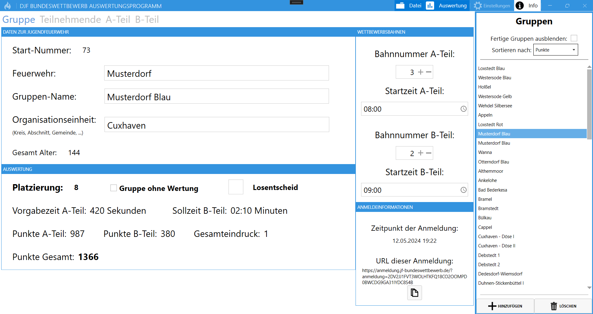
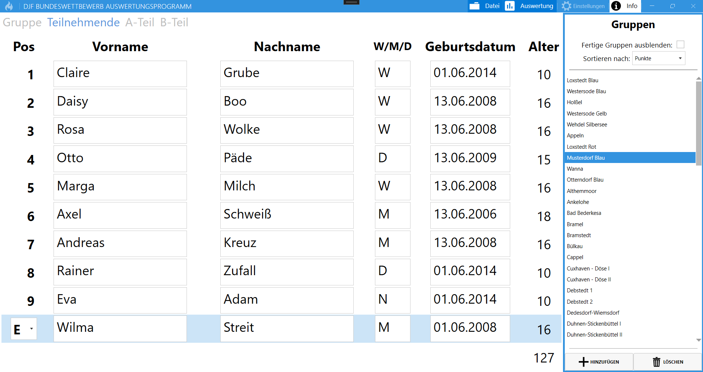
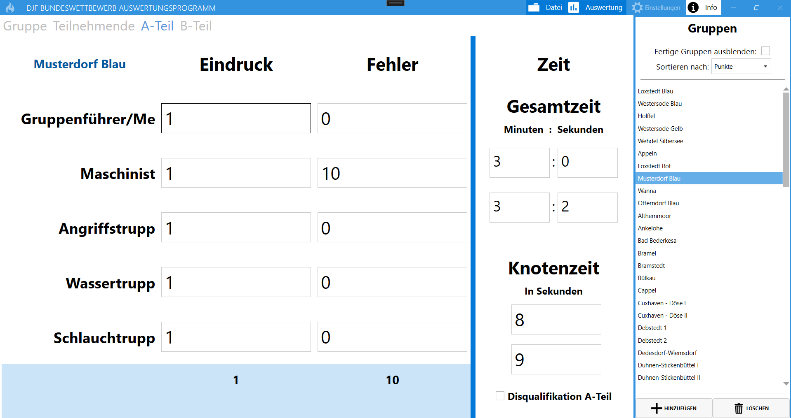
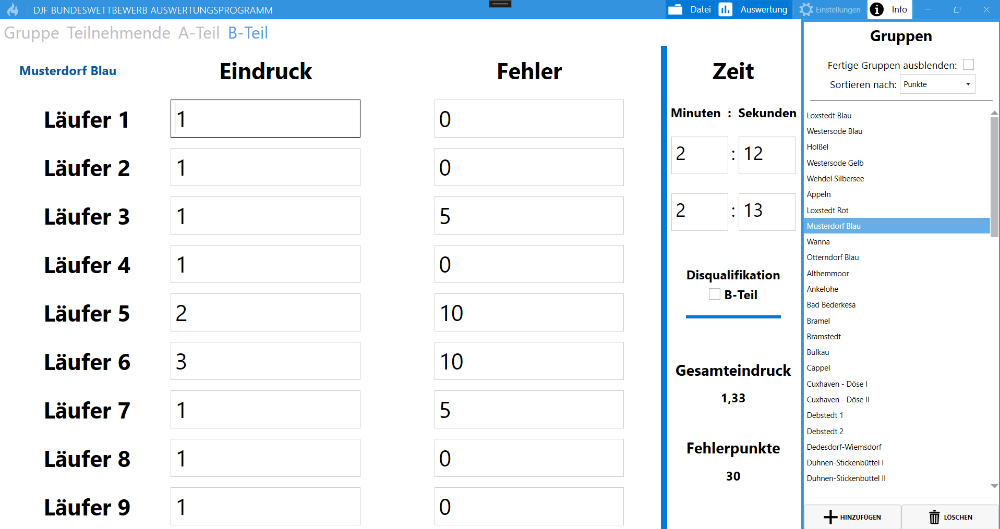
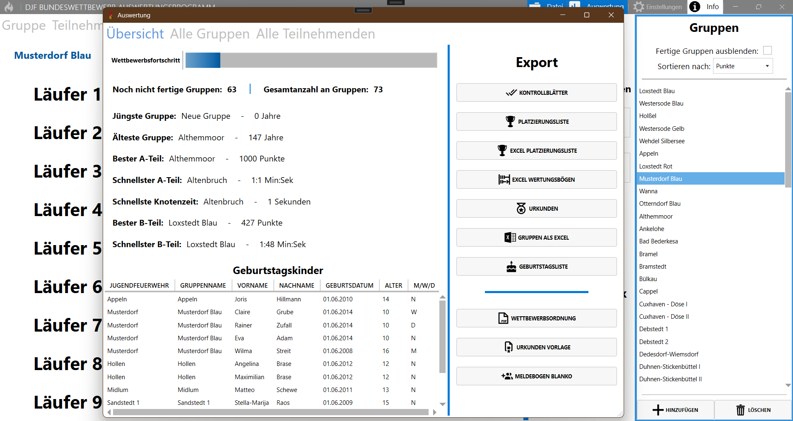

# Auswertungsprogramm JF-Bundeswettbewerb

Auswertungssoftware für den **Bundeswettbewerb der Deutschen Jugendfeuerwehr** (A-Teil Löschangriff und B-Teil 400-m-Hindernislauf).
**Einfach und schnell den Bundeswettbewerb auswerten.**

Die Berechnung folgt der *Wettbewerbsordnung für den Bundeswettbewerb der DJF (Stand 07.09.2013)* und dem Dokument
*„Aktuelles zum Bundeswettbewerb der DJF“ (Stand 01.07.2026)*. Beide Dokumente liegen dem Programm bei
(Auswertung → Export → „Wettbewerbsordnung“) und sind auch auf der Seite der DJF zu finden:
<https://jugendfeuerwehr.de/themen/wettbewerbe/bundeswettbewerb/>

## Inhalt

- [Wichtigste Features](#wichtigste-features)
- [Systemanforderungen](#systemanforderungen)
- [Installation und Updates](#installation-und-updates)
- [Bedienung in Kürze](#bedienung-in-kürze)
- [Berechnung der Punkte](#berechnung-der-punkte)
- [Speicherorte und Datensicherung](#speicherorte-und-datensicherung)
- [Datenschutz](#datenschutz)
- [Fehlersuche](#fehlersuche)
- [Entwicklung](#entwicklung)
- [Screenshots](#screenshots)
- [Lizenz](#lizenz)

## Wichtigste Features

- **Einfacher Anmeldeprozess für Gruppen**
  - Der digitale Meldebogen kann auf jedem Webserver gehostet werden: in einen Ordner auf dem Webspace hochladen, eure Daten eintragen, und schon können sich eure Gruppen anmelden.
  - Die Anmeldungen werden per **SFTP-Sync** abgeholt. Lokale Änderungen (z. B. Umbenennungen) werden dabei wieder hochgeladen.
  - Alternativ: Import ausgefüllter **Excel-Meldebögen** (eine blanko Vorlage ist im Programm enthalten) oder eigener XML-Dateien.
- **Gruppen- und Teilnehmendenverwaltung**
  - 9 Teilnehmende plus 1 Ersatzperson pro Gruppe, Ersatzperson per Auswahlfeld einwechseln.
  - Automatische Prüfung des Alters (10 bis 18 Jahre, Stichtag 31.12.). Unzulässige Werte werden rot markiert.
  - Automatische Berechnung von Gesamtalter und Sollzeit für den B-Teil.
- **Schnelle Eingabe der Wertungsbögen**
  - Zeiten beider Zeitnehmer, Knotenzeit, Eindruck und Fehlerpunkte je Wertungsrichter für A- und B-Teil.
  - Disqualifikation je Teil, „Gruppe ohne Wertung“ und Losentscheid.
  - Option „Fertige Gruppen ausblenden“, damit nur noch offene Gruppen in der Liste stehen.
- **Automatische Auswertung und Platzierung**
  - Platzierung inklusive aller Entscheidungskriterien bei Punktgleichheit (siehe [unten](#berechnung-der-punkte)).
  - Übersicht über den Wettbewerbsfortschritt, jüngste/älteste Gruppe, bester bzw. schnellster A- und B-Teil, schnellste Knotenzeit.
- **Automatische Startzeitenvergabe**
  - Anzahl Bahnen, Startabstand, erste Startzeit, Mindestabstand zwischen A- und B-Teil und Mittagspause sind einstellbar.
- **Exporte (PDF/Excel)**
  - Urkunden (inkl. Urkunde „Jüngste Gruppe“, eigene HTML-Vorlagen möglich), Platzierungslisten (PDF und Excel), Startreihenfolge A/B, Kontrollblätter, Kontrollliste Check-Up-Zelte, Geburtstagsliste, ausgefüllte Wertungsbögen als Excel inkl. Gesamtübersicht, Gruppendaten als Excel.
- **LAN-Abgleich (4-Augen-Prinzip)**
  - Zwei Rechner im gleichen Netzwerk finden sich automatisch und vergleichen alle wertungsrelevanten Eingaben. Abweichungen werden übersichtlich angezeigt.
- **Automatische Backups** alle 10 Minuten
- **Helles und dunkles Farbschema** (oder automatisch nach Windows-Einstellung)

## Systemanforderungen

- Windows 10 Version 2004 (Build 19041) oder neuer bzw. Windows 11, 64 Bit
- Mindestens 4 GB RAM, empfohlen 8 GB (für die PDF-Exporte wird im Hintergrund ein Browser gestartet)
- Internet wird benötigt
  - beim **ersten PDF-Export**: Für die PDF-Erstellung wird einmalig ein Chromium-Browser heruntergeladen (PuppeteerSharp).
  - für SFTP-Sync und die Update-Prüfung beim Programmstart
- Für den LAN-Abgleich: beide Rechner im gleichen Netz, UDP-Port 47800 und TCP-Port 47801 in der Firewall freigegeben (die Ports sind in den Einstellungen änderbar)

## Installation und Updates

Die aktuelle Version gibt es unter [Releases](https://github.com/KJFCux/jf-bundeswettbewerb/releases) als einzelne `BWB-Auswertung.exe`.
Eine Installation ist nicht nötig: Datei herunterladen und starten. Das .NET-Runtime ist bereits enthalten.

Beim Start prüft das Programm, ob eine neuere Version auf GitHub vorhanden ist, und bietet den Download an.

Ausführliche Anleitungen findet ihr auf unserer Webseite:
[Installation des Auswertungsprogramms](https://jf-bundeswettbewerb.de/2024/05/22/installation-des-auswertungsprogramms/)

## Bedienung in Kürze

1. **Einstellungen** öffnen und Veranstaltungsdaten eintragen: Titel, Ort, Datum, Leitung, Wasserentnahmestelle (Art), Logo und Unterschriften für die Urkunden, optional SFTP-Zugang.
   Das **Veranstaltungsdatum** ist wichtig, weil es für die Altersberechnung verwendet wird.
2. **Gruppen anlegen**: per SFTP-Sync, Excel-Meldebogen, XML-Import oder manuell mit „Hinzufügen“.
3. Optional **Startzeiten automatisch vergeben** (Einstellungen).
4. **Wertungsbögen eingeben**. Gespeichert wird automatisch beim Wechsel der Gruppe, beim Schließen und mit `Strg+S`.
5. **Auswertung** öffnen: Fortschritt prüfen und Listen, Urkunden usw. exportieren.

## Berechnung der Punkte

| | Berechnung |
|---|---|
| **A-Teil** | 1000 Punkte − Sekunden über der Vorgabezeit (Unterflurhydrant 6:00 min, offenes Gewässer 7:00 min) − Sekunden für Knoten und Stiche (Zeittakt) − Fehlerpunkte |
| **B-Teil** | 400 Punkte + (Sollzeit − Ist-Zeit in Sekunden) − Fehlerpunkte |
| **Gesamteindruck** | Durchschnitt aller 14 Eindrucksbewertungen (1 = sehr gut … 5 = ungenügend), auf eine Dezimalstelle gerundet und abgezogen |
| **Gesamtpunkte** | A-Teil + B-Teil − Gesamteindruck |

- **Zeiten:** Es zählt der Durchschnitt der beiden Zeitnehmer, kaufmännisch auf volle Sekunden gerundet. Ist nur eine Zeit eingetragen, wird diese verwendet.
- **Sollzeit B-Teil** nach Gesamtalter der 9 Läufer:

  | Gesamtalter | 90–94 | 95–103 | 104–112 | 113–121 | 122–130 | 131–139 | 140–148 | 149–157 | 158–162 |
  |---|---|---|---|---|---|---|---|---|---|
  | **Sollzeit** | 2:40 | 2:35 | 2:30 | 2:25 | 2:20 | 2:15 | 2:10 | 2:05 | 2:00 |

- **Alter:** Stichtag ist der 31.12. des Wettbewerbsjahres, es zählt also der Jahrgang. Ausnahme im Programm: Wer am Veranstaltungstag noch nicht 10 Jahre alt ist, wird mit 9 Jahren geführt und markiert.
- **Reihenfolge bei Punktgleichheit** (Wettbewerbsordnung 2.4):
  1. weniger Fehlerpunkte im A-Teil
  2. besseres Ergebnis im A-Teil
  3. besseres Ergebnis im B-Teil
  4. weniger Fehlerpunkte im B-Teil
  5. besseres Ergebnis bei den Leinenverbindungen (Zeittakt + Fehler Angriffs- und Wassertrupp)\*
  6. Losentscheid (Feld „Losentscheid“, kleinere Zahl = besserer Platz)

  \* Das Programm erfasst die Fehler nur je Trupp, nicht getrennt nach „während des Zeittaktes“. Deshalb werden hier alle Fehler von Angriffs- und Wassertrupp verwendet.
  Ist danach immer noch Gleichstand und kein Losentscheid eingetragen, wird nach Startnummer sortiert, damit die Platzierung stabil bleibt. In diesem Fall bitte einen Losentscheid durchführen und eintragen.

## Speicherorte und Datensicherung

| Was | Ort |
|---|---|
| Gruppendaten (eine XML-Datei je Gruppe) | `Dokumente\BWB-Auswertung\Gruppendaten` |
| Nicht lesbare Gruppendateien | `Dokumente\BWB-Auswertung\Gruppendaten\Fehlerhaft` |
| Einstellungen | `Dokumente\BWB-Auswertung\Einstellungen\settings.xml` |
| Automatische Backups (ZIP, alle 10 Min., die letzten 30) | `Dokumente\BWB-Auswertung\Backup` |
| Exporte (PDF, Excel) | `Dokumente\BWB-Auswertung` |
| Eigene Urkundenvorlagen | `Dokumente\BWB-Auswertung\Vorlagen` |
| Logdateien (nur mit Startparameter `/log`) | `%LOCALAPPDATA%\BWB-Auswertung\log` |

**Wiederherstellen aus einem Backup:** Programm schließen, gewünschte ZIP-Datei aus dem Backup-Ordner entpacken und den Inhalt von `Gruppendaten` bzw. `Einstellungen` in die oben genannten Ordner kopieren.

Tipp: Am Wettbewerbstag zusätzlich regelmäßig über „Export“ eine Kopie auf einen USB-Stick speichern.

## Datenschutz

Das Programm verarbeitet personenbezogene Daten von Minderjährigen (Namen, Geburtsdaten). Bitte beachtet:

- Das SFTP-Passwort wird unverschlüsselt in `settings.xml` (und damit auch in den Backups) gespeichert. Verwendet einen eigenen Zugang nur für die Anmeldungen.
- Der **LAN-Abgleich** stellt die Gruppendaten ohne Passwort allen Rechnern im gleichen Netzwerk bereit. Nutzt ihn nur in einem vertrauenswürdigen Netz (nicht im offenen Hallen-WLAN) oder deaktiviert ihn in den Einstellungen.
- Löscht die Daten nach der Veranstaltung, wenn sie nicht mehr gebraucht werden, auch auf dem SFTP-Server und im Backup-Ordner.

## Fehlersuche

- Das Programm mit dem Parameter `/log` (oder `/v`, `/verbose`) starten. Dann werden zusätzlich Logdateien geschrieben (siehe [Speicherorte](#speicherorte-und-datensicherung)).
  Beispiel: Verknüpfung anlegen und als Ziel `"C:\Pfad\BWB-Auswertung.exe" /log` eintragen.
- Fehler werden außerdem in die Windows-Ereignisanzeige (Anwendung) geschrieben.
- Probleme und Wünsche gerne als [Issue](https://github.com/KJFCux/jf-bundeswettbewerb/issues) melden.

## Entwicklung

- .NET 10, WPF (MahApps.Metro), NPOI (Excel), iText + PuppeteerSharp (PDF), SSH.NET (SFTP)
- Bauen unter Windows mit Visual Studio 2022/2026 oder per CLI:

  ```powershell
  dotnet build BWB-Auswertung/BWB-Auswertung.csproj -c Debug
  dotnet publish BWB-Auswertung/BWB-Auswertung.csproj -c Release --self-contained -r win-x64 -p:PublishSingleFile=true -p:IncludeNativeLibrariesForSelfExtract=true
  ```

  Unter Linux/macOS lässt sich das Projekt zur Kontrolle mit `-p:EnableWindowsTargeting=true` kompilieren (nicht ausführen).
- **Release:** Version in `BWB-Auswertung.csproj` erhöhen (`AssemblyVersion`, `FileVersion`, `Version`) und einen Tag im Format `BWB-Auswertung/vX.Y.Z` pushen. Die GitHub Action baut dann die EXE und erstellt das Release.

## Screenshots

### Gruppenverwaltung

### Teilnehmende

### A-Teil

### B-Teil

### Auswertung


## Lizenz

[GNU Affero General Public License v3.0](LICENSE)
